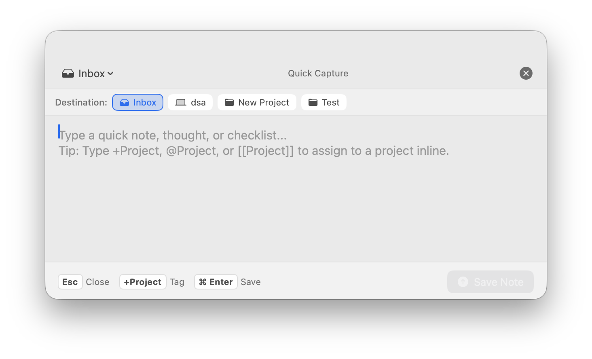
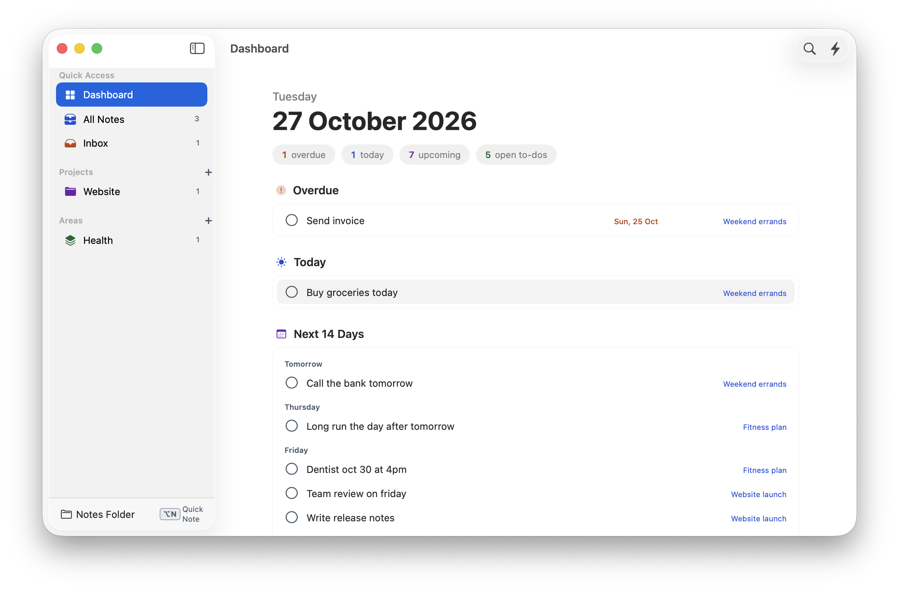

# Scattered Notes

A native app for Mac and Windows, with companion apps for iPhone, iPad and Android, that organises your scattered notes in two steps:

1. **Capture**: jot a thought in seconds from anywhere with a global shortcut (`⌥ + N` on a Mac, `Ctrl + Alt + N` on Windows), no matter what you're doing.
2. **Unify**: the **Dashboard** builds itself from what you wrote. Every to-do and every line that mentions a day ("call the bank tomorrow", "team dinner on friday") is collected from all your notes into one view. There is nothing to set up or maintain.

Notes are stored as plain Markdown files on disk, organised under **Projects** and **Areas**. All the apps use the same files, so one synced folder works on a Mac, a PC and a phone.

  

  

---

## How to install

Go to the [latest release](https://github.com/and/scattered-notes/releases/latest) and download the file for your computer.

### Mac

**Requirements:** macOS 14 (Sonoma) or later. Works on Apple silicon and Intel Macs.

1. Download `ScatteredNotes-<version>-mac.zip`.
2. Double-click the zip to unzip it.
3. Drag **ScatteredNotes.app** into your **Applications** folder.
4. Open it. The app is signed and notarized by Apple, so it opens without a warning.

**First launch**
- The Dashboard opens first. Press `⌥ + N` in any app to capture your first note.
- If the Mac is signed in to iCloud, the app keeps your notes in its own iCloud Drive folder, **iCloud Drive → Scattered Notes**. That folder is shared with the iPhone and iPad app and your other Macs. If you already have notes, the app asks once before moving them.
- Without iCloud, notes are saved in `~/Documents/ScatteredNotes/`. To switch at any time, choose **Scattered Notes → Settings → Notes Folder** and click **Use iCloud Drive**, **Change…** (any folder) or **Use Default**. Existing notes move with it.
- The two global shortcuts, `⌥ + N` (Quick Capture) and `⌥ + F` (search), can be changed in **Settings → Global Shortcuts**. If a shortcut doesn't respond, another app may already use it; pick a different one.
- The app also lives in the menu bar, so Quick Capture and your recent notes are one click away.

**Updating:** from version 1.1.1 the app checks GitHub once a day and, when a new version is out, shows what changed and asks before installing. Click **Install and Relaunch** to update in place, or choose **Scattered Notes → Check for Updates…** at any time. Turn automatic checks off in **Settings → Updates**. Your notes are plain files in the notes folder and are not touched.

**Uninstalling:** quit the app and drag it to the Trash. Your notes stay in the notes folder. To also remove the app's settings, run `defaults delete com.scatterednotes.app` in Terminal.

### Windows (preview)

**Requirements:** Windows 11. The download runs on Intel, AMD and Arm PCs; nothing else needs to be installed.

1. Download `ScatteredNotes-<version>-windows.exe`.
2. Move it somewhere permanent, for example a `Scattered Notes` folder in your user folder.
3. Double-click it. The app is not signed yet, so Windows SmartScreen may say it "protected your PC". Click **More info → Run anyway**.

**First launch**
- The Dashboard opens first. Press `Ctrl + Alt + N` in any app to capture a note, and `Ctrl + Alt + F` to search all notes. Both can be changed in **Settings**.
- Notes are saved in `Documents\ScatteredNotes`. To use the same notes as on a Mac, choose **Settings → Notes folder → Choose Folder…** and pick the folder the Mac uses. For iCloud Drive, install iCloud for Windows and pick `iCloud Drive\Scattered Notes`.
- Closing the window keeps the app running in the notification area (the system tray), so the shortcuts keep working. Use **Quit Scattered Notes** in its menu to stop it. **Settings → Startup** starts it when you sign in.

**Updating:** from version 1.1.1 the app checks GitHub once a day and, when a new version is out, shows what changed and asks before installing. **Install and Restart** replaces the exe in place. You can also choose **Check for Updates…** in the tray menu, and turn automatic checks off in **Settings → Updates**.

**Uninstalling:** quit the app and delete the exe. Your notes stay in the notes folder. Settings are in `%APPDATA%\ScatteredNotes`.

**Building from source:** see [DEVELOPMENT.md](DEVELOPMENT.md).

### iPhone and iPad (preview)

**Requirements:** iOS 17 or later. Coming soon to TestFlight, Apple's beta app, which installs updates automatically. Until then, build it from source with Xcode (see [DEVELOPMENT.md](DEVELOPMENT.md#iphone-and-ipad-app)).

- Four parts: the **Dashboard** (tick to-dos, tap an item to open its note), **Notes** (search, edit, swipe to delete), **Quick Capture** (the pencil on the Dashboard) and **Settings**.
- If the iPhone is signed in to iCloud, notes are kept in **iCloud Drive → Scattered Notes**, the same folder the Mac app uses, and changes from your Mac show up as they sync.
- Otherwise, or after **Settings → Use Folder on This iPhone**, notes are saved on the device and show up in the Files app under **Scattered Notes**. **Settings → Choose Folder…** picks any other folder in Files. Picked folders reload when you switch back to the app, and you can pull down to refresh.

### Android (preview)

**Requirements:** Android 8 or later.

- **From GitHub:** download `ScatteredNotes-<version>-android.apk` from the [latest release](https://github.com/and/scattered-notes/releases/latest) on your phone and open it. Android asks once to allow installing apps from your browser. The app checks GitHub once a day for a new version and asks before installing it; **Settings → Check for Updates** checks at once.
- **From Google Play:** coming soon. Play updates the app itself. The Play and GitHub versions are the same app, so either can update the other.

- The same four parts as on iPhone. Text shared from another app (**Share → Scattered Notes**) opens Quick Capture.
- Notes are saved inside the app. To share them with a computer, choose **Settings → Choose Folder…** and pick a folder a sync app (for example Syncthing, Dropbox or OneDrive) keeps in step with your computer's notes folder.
- The app reloads when you switch back to it, and you can pull down to refresh.

---

## Features

- ⚡️ **Global Quick Capture (⌥ + N)**:
  - Floating Spotlight/Raycast-style HUD modal accessible from anywhere across macOS.
  - Auto-focused multiline editor.
  - Instant project/destination selector (capture directly to `Inbox` or pick an active `Project`/`Area`).
  - Inline `#tag` extraction.
  - Press `⌘ + Enter` to save & auto-dismiss.
  - Press `Esc` to cancel.
- 🗓️ **Dashboard**: your notes' to-dos and plans on one page (see [Dashboard](#dashboard)).
  - Overdue, Today, Next 14 Days and open to-dos, collected from every note.
  - Counters for overdue, today, upcoming and open to-dos.
  - Tick any item off from the dashboard or from the note's agenda column.
- 🔎 **Global Search (⌘ + K or ⌥ + F)**: Spotlight-style palette over all notes with ranked results and highlighted snippets. `⌥ + F` works from any app.
- 📂 **Full 3-Pane View**:
  - **Sidebar**: Quick access to *Inbox*, *All Notes*, *Projects*, and *Areas* with live badge counts and inline creation.
  - **Notes List**: Full-text instant search across titles, contents, and `#tags`. Sort by modified date, creation date, or title.
  - **Markdown Editor**: Syntax highlighting, split view, and live preview.
  - **Interactive Checklists**: Click `- [ ]` checkboxes in live preview or split view to check them off directly.
- 💾 **Local & Open Storage**:
  - Notes are saved as plain `.md` files under `~/Documents/ScatteredNotes/`:
    - `Inbox/`
    - `Projects/<ProjectName>/`
    - `Areas/<AreaName>/`
  - YAML frontmatter maintains metadata (`id`, `title`, `type`, `target`, `tags`, `pinned`).
  - Live directory file watching automatically synchronizes external modifications (e.g. from Obsidian, Finder, or Git).
- 🏷️ **Menu Bar Companion**:
  - Native menu bar status item for instant capture, opening the main window, and accessing recent notes.

---

## Dashboard

The Dashboard is the app's home view: today's date, four live counters (**overdue**, **today**, **upcoming**, **open to-dos**) and a plain list of everything you've written that needs doing, gathered from all your notes in one place. Each item shows which note it came from; click the note name to jump straight to it. Nothing to set up: write a to-do or a day in any note and it shows up here.

It reads every note and lists the lines that need action:

- **Checklist items**: `- [ ] Renew passport`
- **Plain lines that read as plans**, no checkbox needed: lines starting with an action verb (`fix the login bug`, `call the bank`), an intent (`need to renew passport`, `I'll email Sam`, `don't forget the charger`) or `todo`. Questions and lines ending in `:` don't count. Ticking one turns it into `- [x] …`.
- **Dated or relative lines**: any line that mentions a day, even without a checkbox.

| Writes like | Means |
| :--- | :--- |
| `@2026-10-30`, `2026-10-30` | that date |
| `today`, `tonight`, `tomorrow` | day written, or the next day |
| `day after tomorrow`, `in 3 days`, `in 2 weeks` | counted from the day written |
| `the day after` | one day after the closest dated line above it |
| `friday`, `next friday` | next such weekday |
| `next week` | 7 days after the day written |
| `oct 30`, `30 October`, `Oct 30th` | that date (next year if it already passed by more than six months) |
| `22nd of the next month`, `22 of this month` | that day of next or this month (not set if the month has no such day) |
| `on the 22nd` | the next 22nd, today included |
| `end of the month`, `end of next month` | the last day of that month |

**Relative words use the day you wrote the line**, not the day the note was created or last opened. When a note is saved, the app writes the day into the line, like `call the bank tomorrow 📅 2026-10-27`, and `✅ 2026-10-28` when you tick it (the format the Obsidian Tasks plugin uses). So the date is in the file, any other app can read it, and editing or rewording a line later never moves it. Edit the date in the marker if you want a different day; the marker wins over the words. A line written in another app has no marker until the note is next saved in Scattered Notes; until then it is dated from when the note was last updated.

**Project dashboards**: selecting a project or area in the sidebar opens a dashboard with only that project's to-dos and dates. Open a note from the list to edit it; **<Project> Dashboard** at the top of the list brings the dashboard back.

**Completing items**: click the circle next to an item on the dashboard or in the note's agenda column (right margin of the editor, toggled with the sidebar button). Completing a plain dated line turns it into a checked item (`- [x] ...`) in the note.

---

## Privacy

Scattered Notes collects no data. See [PRIVACY.md](PRIVACY.md).

---

## Keyboard Shortcuts

| Shortcut | Action |
| :--- | :--- |
| `⌥ + N` | Trigger Floating Quick Capture HUD (any app) |
| `⌥ + F` | Search all notes (any app) |
| `⌘ + K` | Search all notes (inside the app) |
| `⌘ + ↵` | Save note in Quick Capture |
| `Esc` | Dismiss Quick Capture; in the main window go back to the Dashboard, then hide the window |
| `↵` | On a selected note, start editing it (cursor after the searched word when opened from a search) |
| `⌘ + N` | New Note in current project/inbox (Main Window) |
| `⌘ + Q` | Quit application |

Both global shortcuts can be changed in **Settings → Global Shortcuts**.
